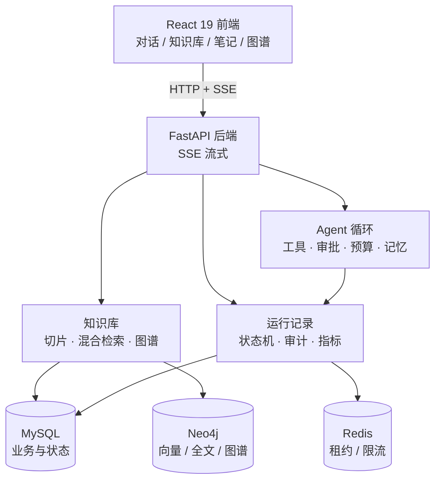

<div align="center">

# MindWeave Harness 智能工作台

**把笔记、文档与知识图谱织成一张可检索的网**

一个能检索、能引用、能读写文件、能执行代码，并且**写操作必须经过你审批**的智能知识工作台。

[](https://www.python.org/)
[](https://fastapi.tiangolo.com/)
[](https://react.dev/)
[]()
[](workbench/mindweave/LICENSE)

</div>

---

## 目录

- [这是什么](#这是什么)
- [能做什么 / 不能做什么](#能做什么--不能做什么)
- [核心特性](#核心特性)
- [架构](#架构)
- [快速开始](#快速开始)
- [使用示例](#使用示例)
- [关键机制](#关键机制)
- [评测](#评测)
- [目录结构](#目录结构)
- [本地开发](#本地开发)
- [参与贡献](#参与贡献)
- [致谢与许可](#致谢与许可)

---

## 这是什么

一个面向个人知识库的智能工作台，由两层组成：

- **知识工作台**：文档摄入 → 混合检索 → 引用溯源 → 知识图谱；
- **MindWeave Harness**：Agent 运行时，负责工具调用、权限审批、会话恢复、上下文预算与评测。

它不是“套壳聊天框”。Agent 的每一步都能被追踪、被审批、被打断、被恢复，也能被 Benchmark 量化。

```text
你问：缓存击穿怎么处理？
它做：检索知识库 → 命中 3 个切片 → 生成回答 → 引用 [1][2] 可点回原文并高亮
你说：把结论写成 notes/cache.md
它做：申请 write_file → 你点批准 → 落盘 → 回读确认
```

适合的场景：

- 个人/团队文档太多，需要一个“能引用原文”的问答入口；
- 想让 Agent 帮忙整理资料、生成文件、跑一段计算，但**不放心它直接改文件**；
- 想研究 Agent 的恢复、审批、预算、评测怎么做，需要一个可读的完整实现。

---

## 能做什么 / 不能做什么

### 能做什么

| 场景 | 行为 |
|---|---|
| 文档问答 | 混合检索 + 引用 + 回跳高亮 |
| 文档对比/摘要 | 多切片证据拼装，标注来源 |
| 创建/修改笔记 | 申请 `write_file`，审批后落盘 |
| 执行计算 | `run_python` 沙箱执行，返回结果 |
| 制定计划 | `plan` 工具输出步骤，可被打断 |
| 检索诊断 | 未命中时给出归因与改写建议 |
| 长期记忆 | 跨会话记住用户偏好，删除后不再注入 |
| 运行审计 | `/metrics`、审批审计、请求 trace |

### 不能做什么（如实说明）

- **扫描版 PDF**：没有文字层时需要视觉模型，当前会导入失败；
- **工具并行**：当前循环每轮一个工具调用，并行调度尚未实现；
- **分布式部署**：单机设计，未做多租户与跨机租约；
- **OS 级沙箱**：`run_python` 做了超时与输出裁剪，但不是安全沙箱，不要跑不可信代码；
- **绝对正确**：模型输出不保证正确，引用是“可核验”，不是“已核验”。

---

## 核心特性

| 能力 | 说明 |
|---|---|
| 🔍 **混合检索** | BM25 + 向量 + 图谱证据，RRF 只融合名次，避免分数量纲问题；候选缺失率 2.33% |
| 📎 **引用溯源** | 回答 `[n]` → 证据切片 → 源文档三级锚点，可回跳并高亮原文 |
| 🧭 **检索诊断** | 未命中区分“问法太泛 / 索引缺失 / 资料不包含”，并给改写建议 |
| 🛠️ **工具调用** | `write_file` / `read_file` / `list_files` / `run_python` / `plan` / `search_rag` / `create_note` |
| 🔐 **人工审批** | 写操作强制审批；支持“本会话都允许”（1h）、30 分钟过期、路径沙箱、审计 |
| ♻️ **可恢复执行** | 中断后标记 `needs_verification`，拒绝自动重试，要求人工核对；重复审批幂等 |
| 🧠 **长期记忆** | 结构化存储、请求时按权威状态注入、删除后不再复活、按用户隔离 |
| 📉 **上下文压缩** | 剪枝优先、摘要兜底、原子提交；token −76% 且保留硬约束 |
| 📊 **可观测** | `/metrics`、审批审计、请求 trace、知识库健康检查 |
| 🧪 **可复现评测** | 8 类任务 Benchmark + SciFact 300 条 + 业务集 50 条 |

---

## 架构



一次对话的请求流：

```text
前端 POST /chat/agent/query/stream
  → 预检索（可选）：混合召回 → 证据注入
  → 模型决策：直接回答 / 调工具 / 生成计划
  → 工具需要审批：返回 interrupt，前端弹窗
  → 用户批准：POST /chat/agent/resume
  → 工具执行 → 结果归档 → 模型继续
  → SSE 逐段返回 response，done 带 ttft_ms
```

运行时核心 `mindweave_harness/` 与产品后端解耦，可单独安装使用。

---

## 快速开始

**前置**：Docker、Node 20+、Python 3.12。

```bash
git clone <你的仓库地址>
cd mindweave-harness-workbench/workbench/mindweave

# 1) 数据库（MySQL / Redis / Neo4j）
docker compose up -d mysql redis neo4j

# 2) 后端（宿主机）
python3.12 -m venv .venv && source .venv/bin/activate
pip install -r backend/requirements.txt
cp .env.example .env
# 编辑 .env：OPENAI_API_KEY / OPENAI_BASE_URL / MODEL_ID
cd backend && uvicorn main:app --host 127.0.0.1 --port 8100
```

```bash
# 3) 前端（另开终端）
cd workbench/mindweave/front
npm install
npm run dev        # http://127.0.0.1:3100
```

打开 `http://127.0.0.1:3100`，注册账号 → 导入文档 → 开始对话。

**首次启动检查清单**

- [ ] `curl http://127.0.0.1:8100/health` 返回 200
- [ ] 注册并登录成功
- [ ] 导入一篇 Markdown，状态变为“已完成”
- [ ] 问一个文档里的问题，回答带 `[1]` 且可点击
- [ ] `/knowledge/health` 显示文档数与切片数

首次导入后图谱构建需要 1–3 分钟，期间检索可用、图谱逐步补齐。

### 端口

| 服务 | 端口 |
|---|---|
| 前端 | 3100 |
| 后端 | 8100 |
| MySQL | 13306（可用 `.env` 的 `MYSQL_PORT` 覆盖） |
| Redis | 16379 |
| Neo4j | 17474 / 17687 |

### 配置（`.env`）

| 变量 | 默认 | 说明 |
|---|---|---|
| `OPENAI_API_KEY` | — | 模型密钥 |
| `OPENAI_BASE_URL` | — | OpenAI 兼容地址 |
| `MODEL_ID` | — | 模型名 |
| `RERANK_ENABLED` | `false` | 是否启用 LLM 重排；A/B 显示收益低于延迟成本 |
| `MAX_TOOL_CALLS` | `20` | 单次运行工具调用上限 |
| `MAX_WALL_SECONDS` | `120` | 单次运行时长上限 |
| `RAG_CONTEXT_CHARS` | `4000` | 注入上下文的证据字符上限 |
| `RATE_LIMIT_ENABLED` | `true` | 本地批量导入可关闭 |

---

## 使用示例

### 1. 文档问答 + 引用

```text
你：缓存击穿怎么处理？
Agent：缓存击穿是热点 key 过期瞬间大量请求回源 [1]。
       处理方式：互斥锁重建、逻辑过期、热点永不过期 [1][2]。
```

回答里的 `[1]` 可以点击，跳到知识库对应文档并高亮切片。

### 2. 创建文件（需要审批）

```text
你：把上面的结论写成 notes/cache.md
Agent：我想创建 notes/cache.md，是否允许？
你：允许（本次会话都允许）
Agent：已写入并回读确认。
```

重复批准同一请求时，服务端返回“没有可恢复的审批”，文件数保持 1。

### 3. HTTP 调用

```bash
# 登录
TOKEN=$(curl -s -X POST http://127.0.0.1:8100/user/login/ \
  -H 'Content-Type: application/json' \
  -d '{"username":"demo","password":"demo1234"}' | jq -r .token)

# 流式提问
curl -N -X POST http://127.0.0.1:8100/chat/agent/query/stream \
  -H "Authorization: Bearer $TOKEN" \
  -H 'Content-Type: application/json' \
  -d '{"query":"缓存击穿怎么处理？"}'
```

---

## 关键机制

### 审批状态机

```text
pending ──claim(行锁)──▶ executing ──finish──▶ completed
   │                        │
   │ 超时 30 分钟            │ 进程崩溃/超时
   ▼                        ▼
expired              needs_verification
```

- `claim` 用 `SELECT ... FOR UPDATE` 保证只有一个执行者；
- `needs_verification` 状态下 resume 直接拒绝，要求人工核对；
- 审计接口 `GET /chat/approvals` 可查历史。

### 可恢复执行

- 启动时扫描超时的 `executing`，标记为 `needs_verification`；
- 恢复时先判定“未派发 / 已派发只读 / 副作用未知”三态，再决定能否续跑；
- 不承诺 exactly-once，承诺“至少一次 + 幂等 + 未知副作用人工核对”。

### 上下文预算

- 五类预算：模型轮次、工具次数、累计 token、单轮输出、总时长；
- 触顶进入 finalizing：给部分答案并禁止继续调工具，而不是直接报错；
- 工具结果超长归档，模型只看到摘要与引用。

### 记忆生命周期

- 写入走接口校验，请求时从 MySQL 按用户重建注入；
- 删除后下一次请求即不再注入；
- 实测：撤销后连续 8 次请求均未注入失效记忆。

### 上下文压缩

- 先剪枝：把可再生的工具结果替换为带 SHA-256 的指针；
- 仍超预算才调模型摘要；
- 压缩结果经“候选 → 原子提交 → 发布”，失败要求恢复。

---

## 评测

### Agent Benchmark（8 类真实任务）

Verifier 直接查文件系统与接口事实，不采信模型自述：

| 任务 | 判定方式 | 结果 |
|---|---|---|
| 知识问答 + 引用 | 含主题词且出现来源或 `[n]` | ✅ |
| 概念对比 | 覆盖向量 / BM25 / 重排关键词 | ✅ |
| 长文摘要 | 长度与来源达标 | ✅ |
| 文件创建 + 审批 | 工作区文件内容等于预期值 | ✅ |
| 代码执行 | 回答包含真实计算结果 | ✅ |
| 计划生成 | 调用 `plan` 工具或输出步骤 | ✅ |
| 未命中拒答 | 明确说明缺资料且不伪造链接 | ✅ |
| 审批幂等 | 重复审批后文件仍只有一份 | ✅ |

```text
tasks 8 / passed 8 / pass_rate 100%
avg_duration 11.0s / tool_calls 4 / safety_violations 0
```

结果文件：[docs/项目记录/benchmark-results.json](docs/项目记录/benchmark-results.json)

### SciFact（BEIR，5,183 篇 / 300 Query）

| 方案 | Recall@5 | Hit@5 | 候选缺失 | 排序缺失 |
|---|---:|---:|---:|---:|
| BM25 | 72.43% | 74.67% | 10.67% | 14.67% |
| 向量 | 76.69% | 78.33% | 5.00% | 16.67% |
| 混合 RRF | 76.37% | 78.33% | **2.33%** | 19.33% |
| + bge-reranker | — | **78.67%** | — | — |

> 混合把候选缺失从 5% 降到 2.3%，瓶颈转向排序；重排只涨 0.33pp、多花约 0.6s，因此做成开关而不是默认开启。

### 业务集

50 条可答问题：Recall@5 **0.96**、MRR@5 **0.89**；TTFT 从 11.3s 降到 **P50 6.3s**。

### 复现

```bash
# 8 类任务（需要后端 8100 在跑）
python workbench/benchmark/run.py

# SciFact 检索与重排
HF_ENDPOINT=https://hf-mirror.com python workbench/eval_scifact.py
HF_ENDPOINT=https://hf-mirror.com python workbench/eval_scifact_rerank.py
```

---

## 目录结构

```text
mindweave_harness/           Agent 运行时
  loop/                      循环与轮次
  tool/                      工具注册、校验、调度、结果
  session/                   Transcript、Checkpoint、恢复
  context/                   预算、压缩、装配
  memory/                    长期记忆生命周期
  plan/                      计划
  adapters/                  CLI / Web 入口
workbench/
  mindweave/
    backend/app/agent/       工具、审批、聊天循环
    backend/app/rag/         混合检索、rerank、证据选择
    backend/app/services/    文件工作区、聊天流、运行存储
    front/src/pages/         对话 / 知识库 / 图谱 / 设置
    front/src/components/    侧边栏、引用卡、抽屉
    docker-compose.yml       MySQL / Redis / Neo4j
  benchmark/                 8 类任务 Benchmark 与 Verifier
  eval_scifact.py            SciFact 检索评测
  eval_scifact_rerank.py     SciFact 重排 A/B
eval/                        Harness 故障注入与恢复契约评测
tests/                       Harness 回归测试（428 个）
docs/
  上下文管理设计.md
  项目记录/                  Benchmark 结果、实验数据
```

---

## 本地开发

```bash
# 运行时测试
python -m unittest discover -s tests

# 前端类型检查与构建
cd workbench/mindweave/front
npx tsc --noEmit -p tsconfig.app.json
npx vite build

# 后端语法检查
python -m compileall -q workbench/mindweave/backend/app
```

提交前确保以上命令通过；Benchmark 需要后端与数据库在运行。

---

## 参与贡献

欢迎 Issue 与 PR。提交前请确保：

```bash
python -m unittest discover -s tests
cd workbench/mindweave/front && npx tsc --noEmit && npx vite build
```

提交信息建议用 `feat:` / `fix:` / `docs:` / `refactor:` 前缀。

---

## 致谢与许可

- 工作台前端与知识库骨架基于开源项目 [RAGNotebook](https://github.com/RMA-MUN/RAGNotebook)（MIT），见 [LICENSE](workbench/mindweave/LICENSE)；
- 运行时、检索评测、Benchmark 为本项目实现。

<div align="center">

如果这个项目对你有帮助，点个 ⭐ 支持一下。

</div>
